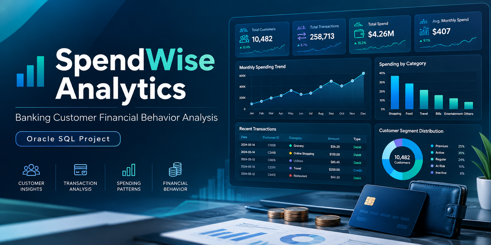

# SpendWise Analytics
Banking Customer Financial Behavior Analysis

# SpendWise Analytics — Banking Customer Financial Behavior Analysis

## Project Overview

**SpendWise Analytics** is a Data Analytics project that uses Oracle SQL to analyze banking customers' income, expenses, and financial behavior.

The main objective of the project is to monitor customers' monthly cash flow, examine spending patterns, and identify financial behavior indicators that may require attention.

## Dataset

The project uses two database tables:

- `IM_CUSTOMERS` — 5 sample banking customers and their segments (MASS, PREMIUM).
- `IM_TRANSACTIONS` — 120 sample banking transactions covering January–June 2026.

Transactions are divided into four categories:

- **SALARY** — Salary income
- **SHOPPING** — Shopping expenses
- **SUBSCRIPTION** — Subscription payments
- **BILLS** — Utility payments

## SQL Analysis

### 1. Monthly Income and Expense Analysis

Calculates customers' monthly income, total expenses, and net cash flow.

### 2. High Spending Ratio Analysis

Identifies customers who spend 80% or more of their monthly income.

### 3. Month-over-Month Spending Comparison

Uses the `LAG` function to compare customers' current and previous monthly expenses.

### 4. Subscription Spending Analysis

Calculates customers' subscription expenses and total spending.

### 5. Customer Spending Behavior Analysis

Classifies customers' monthly spending behavior into three categories:

| Status | Description |
|---|---|
| `NEGATIVE_CASHFLOW` | Expenses exceed income |
| `HIGH_SPEND_RATIO` | Expenses account for at least 80% of income |
| `NORMAL` | Expenses are less than 80% of income |

## Technologies and SQL Skills

- **Oracle SQL** — Data management and analysis
- **Oracle SQL Developer** — SQL query execution
- `CREATE TABLE` — Creating database tables
- `INSERT INTO` — Inserting data
- `SELECT`, `WHERE`, `HAVING` — Data retrieval and filtering
- `SUM`, `GROUP BY` — Calculating income and expenses
- `CASE WHEN` — Conditional analysis
- `LAG` — Month-over-month spending comparison
- `TRUNC` — Grouping dates by month
- `ORDER BY` — Sorting query results

## Project Files

| File | Description |
|---|---|
| `01_schema.sql` | Creates the database tables |
| `02_seed_data.sql` | Inserts sample banking data |
| `03_analysis.sql` | Analyzes customer financial behavior using SQL |

## How to Run

1. Open Oracle SQL Developer.
2. Run `01_schema.sql` to create the database tables.
3. Run `02_seed_data.sql` to insert sample data.
4. Execute the queries in `03_analysis.sql` to analyze the results.

## Conclusion

This project calculates customers' monthly income and expenses, examines spending trends, and identifies key indicators of financial behavior.

**SpendWise Analytics** is a portfolio project that demonstrates the practical application of Data Analytics skills in the banking sector, including SQL-based data analysis and the interpretation of results from a business perspective.

## Disclaimer

All data used in this project is synthetic and created for educational purposes. Customer behavior classifications are based on predefined rules and do not represent a validated credit scoring, fraud detection, or customer churn prediction model.
